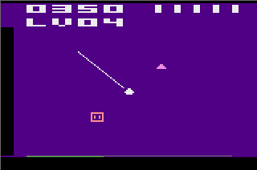
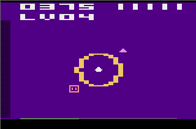
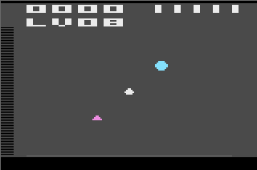
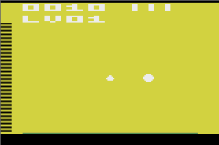

# Atari ZeroWave

A native Atari 2600 prototype of the stationary-turret game described in
[the port outline](docs/PORT_OUTLINE.md) and [implementation spec](docs/IMPLEMENTATION_SPEC.md).
The cartridge targets NTSC, uses ordinary 8 KiB F8 banking, and needs no extra RAM.

The current build has one beam shot per joystick flick, seven enemy variants,
five player health points, a four-digit score, and levels that introduce variants
gradually. It keeps the thin beam, expanding bomb ring, destruction bursts, and
combat sounds. Level 1 allows two enemies; level 2 onward allows four, with rapid
replacements, wave-completion explosions, a wave-progress bar, and a half-second
bomb recharge. From wave 2, two squares can approach together.

## Screenshots

Captured in Stella from the playable ROM using scripted gameplay scenes.

| Directional beam | Expanding bomb |
| :---: | :---: |
|  |  |
| **Later enemy variants** | **Wave complete** |
|  |  |

## Build and run

Prerequisites: Git, Make, a C compiler, Python 3, and Stella. The optional automated
Stella check also needs Linux/X11, Xvfb, xauth, libX11, and libXtst.

```sh
make bootstrap  # Fetch pinned DASM 2.20.14.1 and py65 1.2.0 into .tools/
make check      # Generate assets, assemble, and test the actual ROM
make dist       # Package the playable ROM, matching source, and GPL notices
make run        # Open Stella with NTSC/F8, joystick settings, and audio enabled
```

The playable ROM for copying or sharing is `dist/zerowave.bin`. `make dist`
builds it on its own; normal builds (`make` or `make all`) also keep this copy
up to date. `dist/` also contains `LICENSE`, `NOTICE`, and
`zerowave-source.tar.gz`, built from the current working tree so local
changes are included. Share the matching source archive and notices with the ROM.
The development ROM remains in `build/` alongside symbols, assembly
listing, and a checksum/bank-usage report. `make debug` opens Stella's debugger.
`make clean` removes generated output under `build/` and `dist/`, including captures. Tool downloads
stay in `.tools/`; nothing is installed globally. A separately installed assembler
can be selected with `make DASM=/path/to/dasm`.

Make is optional for launching an existing ROM: open the `.bin` in Stella or run
`stella -audio.enabled 1 build/atari-zerowave.bin`. `make run` also rebuilds it when sources change.

## Controls

Use a joystick in the left port. These are Stella's default keyboard bindings;
custom mappings can be changed in its input settings.

| Control | Stella key | Prototype behavior |
| --- | --- | --- |
| Joystick direction | Arrow keys; combine two for diagonals | Push from center to fire once; center again before the next shot |
| Joystick button | Space | Start/restart; during play, bomb on a fresh press if ready |
| SELECT | F1 | No effect in the playable ROM |
| RESET | F2 | Start a fresh run with five HP and zero score |

Press Space at `FIRE` to start. The upper-left number is your score; the five
white marks on the right are health. Aim along an enemy's approach lane to shoot
it. A square fills in when it enters bomb range. At zero health, `OVER` appears
and the final score stays visible; release and press Space again, or use F2, to restart.

| Enemy | Damage accepted | Enemy health | Movement | Player damage on contact | Score |
| --- | --- | ---: | --- | ---: | ---: |
| Green triangle | Beam only | 1 | Standard | 1 | 10 |
| Small magenta triangle | Beam only | 1 | Fastest | 2 | 20 |
| Pink square | Bomb only | 1 | Standard | 1 | 25 |
| Large armored square | Bomb only | 2 | Slow | 1 | 50 |
| Blue diamond | Beam or bomb | 3 | Accelerates toward the turret | 1 | 40 |
| Amber/orange square (level 6) | Bomb only | 1 | 1.5× standard square speed | 1 | 35 |
| Cyan hexagon (level 8) | Bomb only; beam hurts the player | 1 | Standard | 1 | 60 |

Each shot or bomb deals one damage to a vulnerable target. The large square
shrinks to an ordinary square after its first bomb hit. The diamond needs three
hits, using separate beam flicks, bombs, or both. Health, speed, and spawn weights
are provisional playtest values in `config/tuning.json`.

Each fresh beam shot on a hexagon's lane costs **1 player HP**, with the red
damage flash and a distinct electrical rejection buzz; the hexagon flashes and survives. Holding the stick
or letting the beam fade causes no extra damage. One in-range bomb defeats it.
A simultaneous bomb resolves first, so a successful bomb prevents retaliation.
Contact still costs one HP separately. Hexagons stay filled at every distance;
the expanding bomb ring shows their range boundary.

The orange square arrives in level 6 and the hexagon in level 8, replacing
some square spawns while keeping the current spawn intervals and enemy caps.

Enemies approach along eight lanes, with up to four active from level 2 and no duplicate
lanes. The first spawn arrives about 0.4 seconds after starting. Wave 1 permits
one bomb-only enemy; later waves permit two, counting all squares and hexagons
together. They remain at least 72 updates (1.2 seconds) apart at spawn and leave
two slots available for beam targets. The diamond uses speeds 32, 48, then 64/256 as it gets closer; the
magenta triangle stays fastest at 80/256. Score saturates at 9999.

Crossing each 1,000-point mark restores **1 HP**, up to five. A kill can land
exactly on the mark or pass it. Restoring health gives two cyan screen flashes
and a rising four-note chime over about half a second, then the current level
background returns. At full HP, the bonus instead destroys every surviving enemy,
including armored squares and diamonds, with two yellow flashes and a longer
descending explosion sound. Cleared
enemies count toward wave progress but add no points. Their destruction bursts
play, and the spawn countdown restarts for a short gap before enemies return.
The choice uses HP after contact and retaliation damage: healing back to five does not also clear.
Fatal damage takes priority; healing cannot revive a game-over run.
Damage feedback also overrides the bonus cue. The capped score allows bonuses
at 1,000 through 9,000 points; restarting resets the milestones.

Bombs recharge after 30 updates (about half a second); there is no readiness indicator.
Holding the button produces one bomb; pressing during cooldown does not queue
another. The gold bomb outline expands through four sizes over 16 updates
(about a quarter-second), ending at the bomb's range. During that animation,
ring and beam frames alternate. Outside bombs a beam's fade appears every frame.
Each new shot selects the next bright palette color, deals damage once, and
fades automatically over 15 updates (about a quarter-second), using
[Laser Blast's brightness countdown](docs/KERNEL_TIMING.md#effect-scheduling).
The shot keeps its direction and hue throughout the fade. Holding the stick
does not fire again; moving directly between directions does not fire or steer
the old shot. Return the stick to center before each new shot. A new flick can
replace an unfinished fade. Each shot also plays a short sound.

Starting or resetting with a direction held does not fire a beam; center first.
Starting or resetting with the button held does not fire a bomb; release first.

Vertical and diagonal beams use the TIA ball at one color clock wide. Diagonals
advance at most one color clock per physical scanline, giving a connected thin
line. Left/right beams retain their existing two-scanline thickness and reach.
Both techniques use the same palette and automatic shot fade.

Bomb damage happens once, immediately on the accepted press, within a fixed
radius. The expanding ring is visual feedback; an enemy entering it afterward
survives. Beam shots deal damage even on ring display frames; the fading beam
does not damage later arrivals. Triangles are immune to bombs, and squares are
immune to the beam. A diamond can take one damage from each weapon in the same
update, but awards score only once when destroyed.

An ineffective attack flashes its target bright yellow/orange and gives the
sprite a small sideways shake for 18 updates (about 0.3 seconds). A successful
nonlethal hit flashes white for six updates (about 0.1 seconds). Damage feedback
takes priority when both weapons hit at once. Misses, out-of-range bombs, held
controls, and cosmetic beam/ring animation do not trigger more flashes.

Player damage flashes the whole background red, including behind the HUD, then
fades over 12 updates (about 0.2 seconds), then restores the current level
background. The flash also plays on
the final hit before game over. Further contacts still deal damage; a new hit
restarts the flash, and starting/resetting a run clears it.

Destroyed enemies leave a short burst at the hit position: a white flash, gold
sparks, then dim red embers over 18 updates (about 0.3 seconds). Kills and score
apply immediately. A burst temporarily occupies the old sprite slot, so a new
spawn may wait for it to finish when the level's display slots are occupied.

For this playtest, check deliberate diagonal flicks, repeat shots at diamonds,
the magenta triangle's urgency, the attack/player-damage feedback, and whether armored
squares leave enough time for two bombs. Let enemies through once to compare
ordinary contact damage with the small triangle's double damage.

## Levels

The upper HUD shows score on the left, health on the right, and the current level
below (`LV01` means level 1). The thin green bar at the bottom fills from left to
right in eight steps as kills accumulate; the dim gray rail marks the full wave.
Damage and enemies reaching the turret do not advance it. The bar resets when
the next wave begins. There is no numeric remaining-kills counter.
It appears when play starts; both the rail and fill are hidden on the title and
game-over screens.
When the kill quota is met, the bar stays fully green and the current level
holds briefly. The next update clears surviving enemies with destruction bursts,
two yellow screen flashes, and the same descending explosion used by the full-HP
1,000-point bonus. This wave reward works at any remaining HP and adds no points
or health. After 32 updates (about half a second), the next level starts with an
empty bar and its normal spawn countdown. Health and score carry over.
If the finishing attack also causes nonfatal damage, the red feedback finishes
before the celebration. Fatal damage takes priority. Held controls must be
released before attacking again; inputs during the clear are consumed.
The existing 1,000-point rewards still apply. RESET starts level 1 with five
health and zero score, including during the celebration.

Each level keeps its own dark background for the entire wave. The eight-color
cycle is black, navy, teal, plum, forest green, brown, indigo, then charcoal;
level 9 returns to black and the cycle repeats. It continues independently of
the enemy-mix table, which stops changing after level 8. Kill quotas keep growing
until level 15. Enemy, beam, and HUD colors stay unchanged. Red damage feedback temporarily overrides the background,
then restores it, including on game over. A new run resets to level 1 and black.
At the displayed level cap of 99, the background stays on level 99’s color.

| Level | Enemy mix / change | Cap | Kills | Minimum spawn delay |
| --- | --- | ---: | ---: | ---: |
| 1 | Standard triangles and squares | 2 | 8 | 0.4 s |
| 2 | Adds fast magenta triangles | 4 | 12 | 0.2 s |
| 3 | Adds armored squares | 4 | 16 | 0.2 s |
| 4 | Adds blue diamonds | 4 | 20 | 0.17 s |
| 5 | Same mix, shorter spawn interval | 4 | 24 | 0.13 s |
| 6 | Adds faster orange squares; greater diamond weight | 4 | 28 | 0.13 s |
| 7 | Larger kill quota | 4 | 32 | 0.13 s |
| 8 | Adds retaliating cyan hexagons; final enemy mix | 4 | 36 | 0.13 s |
| 9 | Same mix; larger kill quota | 4 | 40 | 0.13 s |
| 10–14 | Faster arrivals; four more defeats per level | 4 | 44–60 | 0.067 s |
| 15 onward | Quota reaches its cap | 4 | 64 | 0.067 s |

Smaller delays mean more frequent enemies when space is available. Levels 8–9
give the hexagon two waves at the established pace; from level 10, the minimum
delay drops from eight updates to four. The level cap,
destruction bursts, bomb-only spacing, and safe sprite separation can defer them.
Two vertically separated enemies share each draw phase. The spawner checks their
approach times so both pairs remain drawable as they converge on the turret.
From level 2, new horizontal entries are fast triangles; other types use vertical
or diagonal lanes. This leaves enough room for the second enemy in each pair.
Failed placements retry after two updates. Every enemy is drawn at least every
other frame. Enemy speeds stay
at the tested type settings, including diamond acceleration. All squares and
hexagons share the two-target limit from wave 2. A bomb damages every eligible
target in range, so it can hit both squares together.
Each level requires four more defeats: 8, 12, 16, 20, and so on, capped at 64
from level 15 onward. The progress bar uses that level's full quota. Levels
after 8 retain the final enemy mix and four-enemy screen limit; the shorter delay
from level 10 continues through level 99.
The displayed number stops at 99 and play continues. The quota rule and spawn
rows and the `late_spawn` setting live in `config/levels.json`.

## Sound and Stella setup

`make run` explicitly enables audio, even if Stella's saved configuration has it
disabled. It keeps your existing volume. For a known volume, use
`make run STELLA_AUDIO='-audio.enabled 1 -audio.volume 80'`.
When opening the ROM directly, enable audio in Stella's Audio Settings and check
its volume and your system's application/output volume. The title screen is silent:
press Space to start, then tap an arrow for a beam or release and press Space for a bomb.

| Event | Sound |
| --- | --- |
| Beam shot | Short high tone; one per joystick flick |
| Magenta triangle approaching | Descending whistle that grows louder near the turret |
| Bomb without a hit | Short noise burst |
| Ineffective attack | Low rejection buzz |
| Successful nonlethal hit | Short, crunchy noise impact with a sharp attack and quick fade, about 0.13 seconds |
| Enemy destroyed | Falling noise explosion |
| Health restored | Rising four-note chime with two cyan screen flashes |
| Full-health bonus or wave completion | Descending explosion over about half a second with two yellow flashes |
| Player damaged | Harsh descending buzz with the red flash |
| Beam hits a hexagon | Distinct alternating electrical buzz, about 0.2 seconds, with the red damage flash |
| Game over | Four descending notes over about 0.6 seconds |

The beam has its own channel. The other channel prioritizes game over, hexagon
retaliation, ordinary player damage, all-clear, health recovery, destruction, successful hit, rejection, then an empty bomb. A bomb that
hits something plays the outcome cue. Higher/equal-priority events interrupt an
unfinished cue; lower-priority events are discarded. Multiple kills in one update
make one explosion. When that channel is free, the nearest live magenta triangle
produces a dive-bomb whistle as it closes in. Its pitch falls and its
volume rises with proximity; all combat cues interrupt it. After an interruption,
it follows the nearest surviving triangle at its current distance. The beam
remains audible on its own channel. Destroying the triangle or letting it reach
the turret ends its warning. Reset/restart silences both channels immediately;
the game-over tone otherwise finishes after play stops. Audio segments are tunable in
`config/audio.json` as `[updates, waveform, frequency divider, volume]`, ordered
from lowest to highest priority. The `fast_approach` settings control the warning
range, waveform, starting divider, and starting volume. The visual Stella checks
intentionally mute audio inside their separate configuration directories.
Separate actual Stella recordings of the healing chime and all-clear sound are
indexed by `build/audio-captures/latest-healing.json` and
`build/audio-captures/latest-clear.json`. The wave-completion trigger also has a
recording at `build/audio-captures/latest-wave-clear.json`.

## Static display test

`make all` also builds `build/atari-zerowave-display.bin`. Open it with
`make run-display` to revisit the earlier visual fixtures without combat.

In that ROM, SELECT cycles through N, NE, E, SE, S, SW, W, and NW single-target layouts, then
east/west at the same height, two diagonals near the turret, and a north/south pair.
Triangles are green. Squares are pink and fill in when inside bomb range. The SE
layout demonstrates this cue. These are visual fixtures: firing does not remove
them. Two-target layouts alternate one enemy per frame, so each appears at about
30 Hz. The turret remains present every frame. The beam appears at 60 Hz normally;
during bombs, beam and ring each appear at about 30 Hz. Bombs do not reduce enemy
appearances further.

## Validation and development

`make check` runs 106 tests covering generated geometry, all joystick combinations,
button edges and exact cooldown boundaries, both startup banks, stack/guard
integrity, fixed frame lengths, kernel write deadlines, and display fairness.
Audio tests check exact TIA envelopes and expiry, simultaneous-event priority,
preemption/retriggering, coalesced kills, and silence on reset/restart. Warning
checks cover proximity, nearest-triangle selection, all event priorities,
beam coexistence, and stopping on death/contact or outside play.
Health-bonus tests cover every 1,000-point threshold, overshooting, the five-HP
cap, full-health clears of every type, wave credit without extra points, old
burst preservation, respawning, multi-kills, simultaneous contacts, fatal damage, score saturation, cue
priority, distinct cyan/yellow flashes and sound envelopes, exact cue duration,
level-color restoration, and restart.
Level tests cover kill quotas, multi-kills, a full green bar before the clear,
bursts for every surviving type, the 32-update celebration, score-bonus overlap, held inputs, death/reset priority, all spawn mixes, level digits,
every background with all enemy types and simultaneous attacks, persistence
beyond the former pulse duration, damage priority/restoration, restart/reset,
quota growth/capping and palette cycling through all 99 BCD levels,
the level-10 delay change and exact first/replacement spawn timing,
the blank lower-right HUD, write deadlines, level 99 saturation, and a natural run through
the opening four levels. Density tests cover all 2,401 four-target type combinations,
both render phases, safe horizontal approaches through destruction bursts, and
1,800 frames each of natural four-enemy spawning in levels 2, 6, and 8, plus
2,400 frames at level 10, without excess omissions.
Wave-bar checks cover every progress step at all quota sizes, over-quota debugger
values, and exact raster deadlines. Bomb-only tests check all squares and hexagons against
the cap and spacing, two armored targets dying to two ready bombs, and natural
mixed-square survival without player damage.
Footer checks verify that the bar appears during play and completion, clears sprites and
beam pixels beneath the arena, and resets correctly on a fresh run.
Tests check every animation stage for presses on either frame phase, actual
playfield data, ball motion/enable timing, uniform beam color, sprite rows, every palette phase,
continuous beam state, and the separate short sound envelope. Release tests cover
all eight directions and hues, the exact fade countdown, immediate sound cutoff,
re-aiming, reset, and simultaneous bombing with two enemies.
Combat checks cover all lane/radius coordinates, fixed-point boundaries, attack
priority, BCD score carries/saturation, start/reset input edges, spawn limits,
square spacing, HUD digits/health, and a scripted survival run of at least 1,400
frames that encounters and defeats the five early types. Late-variant checks
cover orange-square speed, hexagon retaliation once per flick, bomb-first
protection, contact/death/healing order, later-level spawn weights, and timing
with four targets, sound, score carry, wave advancement, and due spawns.
New checks also cover flick rearming,
fading while held/released, every weapon/type pair, nonlethal/immunity flashes,
two-bomb armor, accelerating movement, and double contact damage. Feedback checks
cover all immunity stages on both draw phases and the red background throughout
the HUD and arena, including repeated hits, reset, and fatal damage.
Burst checks cover all eight hit directions, every animation stage, double bomb
kills, surviving-enemy visibility, spawn deferral, expiry, and reset/game over.
`build/combat-timing.json` records the measured update/prepare costs and stack use.
The CPU tests execute the assembled cartridge using py65 and a limited VCS bus;
they do not simulate TIA pixels.

```sh
xvfb-run -a make stella-check
```

This runs both ROMs in isolated Stella windows and checks 262-line timing.
The display ROM saves 56 TIA snapshots: neutral, both phases of all eight
directions, all 16 bomb frames, and both phases of the three overlap layouts
during the largest ring, plus the last held beam, all 15 release frames, and the
cleared frame. Results are indexed by
`build/stella/latest.json`. The playable ROM adds 68 captures of natural movement,
two-enemy drawing, kills, exact bomb-range boundaries, game over/restart, and HUD
values, destruction-burst stages, variant portraits, manual multi-shot damage,
armor loss, immunity/hit flashes, double contact damage, and red-flash fade/reset,
indexed by
`build/stella/latest-combat.json`. Validated with Stella 6.0.2. See
`build/stella/latest-levels.json` for the level pass's 81 captures of wave completion and clearing, level/progress HUD, held controls, level 99, reset, and
two-square combat, all eight backgrounds with every enemy variant, health recovery/full-health clears, and damage priority. See
[kernel timing notes](docs/KERNEL_TIMING.md) for the measured budgets and limits.
The density script adds 32 captures via `build/stella/latest-density.json`.
This build passed CPU/register checks. SDL dummy-video captures of the four-enemy
kernel are indexed by `build/stella/latest-headless-four-density.json` (32 images).
The updated wave HUD and paired squares appear in
`build/stella/latest-headless-four-levels.json` (81 images); inspected examples
cover the hidden title/game-over bar, bottom progress display, full-bar celebrations and next-wave starts, two-square combat, and persistent level colors with enemy silhouettes, and both milestone rewards.
These contain images rather than a debugger state/timing log.
Run `make stella-check` in a graphical session for the full scripted debugger pass. Television flicker, real joystick diagonals, and sound still
need a hardware pass.

Assembly lives in `src/`; `config/` contains tuning and static fixtures;
`tools/generate_assets.py` produces the shared graphics tables. The independent
Godot reference checkout in `res/` is ignored by this repository.

Next is playtesting the paired squares at the accepted four-enemy pace and whether
the bar makes wave progress clear. More than four
simultaneous enemies would require revising the RAM map and render schedule.

## License

Copyright (C) 2026 mastergray.

Except where otherwise noted, this project's original code, data, artwork, and
documentation are licensed under the **GNU General Public License, version 3
only** (`GPL-3.0-only`). See [LICENSE](LICENSE) for the complete terms and
[NOTICE](NOTICE) for third-party notices and source-build instructions.

You may use, modify, and redistribute the game under GPLv3. When distributing
covered derivative works, you must keep them under GPLv3 and make their
corresponding source available as the license requires. Private modifications
and commercial distribution are allowed. The game comes without warranty.

The vendored DASM header retains its upstream license and attribution in
[vendor/dasm/](vendor/dasm/README.md). Locally downloaded tools and the separate
Godot reference checkout retain their own licensing and are not included in
the release source archive.

## Local repository

The branch is `main`, with repository-local identity
`mastergray <me@mastergray.com>`. The remote is
[mastergray/atari-zerowave](https://github.com/mastergray/atari-zerowave).
For the personal GitHub SSH identity, use
`git@github-mastergray:mastergray/atari-zerowave.git`. The local history includes
the original port outline and implementation specification.
